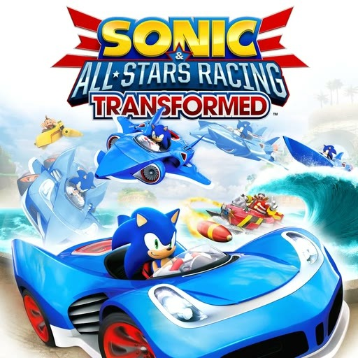

<p align=center></p>

<h1 align=center>Sonic &amp; All-Stars Racing Transformed: Nintendo Switch port</h1>

<p align=center><b>sasrt-nx 1.0.1</b> · <a href="https://chanseyisthebest.github.io/sasrt-nx-installer/">web installer</a> · <a href="https://github.com/ChanseyIsTheBest/sasrt-nx/releases/tag/v1.0.1">release</a></p>

An unofficial native port of the Xbox 360 version of **Sonic & All-Stars Racing Transformed**, made by static
recompilation with [ReXGlue](https://github.com/rexglue/rexglue-sdk). No emulator.

This repository contains no game files. You need your own copy of the game.

## Playing it on the Switch

1. Open the web installer: **https://chanseyisthebest.github.io/sasrt-nx-installer/**
2. Give it your disc image, Games on Demand package or extracted game folder (and the Bonus Pack DLC if you have it).
3. Extract the `sasrt-nx.zip` it downloads to the root of your SD card and follow the page's steps.

Features:

- Single player, story mode and 2-4 player split screen; Bonus Pack DLC supported.
- Native Switch renderer with dynamic resolution, 540p-720p in handheld and docked.
- 30 fps cap by default (up to 60 in the game menu: hold A+B+X+Y+L+R).
- Four CPU cores when started from a Sphaira forwarder.
- Logging off except crash reports. For a bug report, set `log_level = "info"` at the top of
  `switch/sasrt-nx/sasrt.toml` and send the `switch/sasrt-nx/logs/` folder.

## Building on Windows

Needs VS 2022 Build Tools, LLVM clang 20, Python 3 and Git (paths in `tools/win/env.ps1`).

```powershell
# 1. Extract your game (or tools\extract_iso.py for a disc image)
python tools\god_extract.py "<...>\5345085D\00007000\97A9A171AADA666596EA"

# 2. Third-party sources
python tools\fetch_thirdparty.py

# 3. Build the code generator
powershell -File tools\win\run.ps1 out\host_configure.log "cmake -S sdk -B out/host -G Ninja -DCMAKE_BUILD_TYPE=Release -DCMAKE_C_COMPILER=clang -DCMAKE_CXX_COMPILER=clang++ -DREXGLUE_USE_VULKAN=OFF"
powershell -File tools\win\run.ps1 out\host_build.log "cmake --build out/host --target rexglue"

# 4. Translate the game to C++ (the first run fails validation until thunks.toml exists: expected)
$env:REXGLUE_DUMP_IMAGE = "$PWD\out\default_image.bin"; powershell -File tools\codegen.ps1
python tools\thunk_table.py
powershell -File tools\codegen.ps1

# 5. Build and run the PC version
powershell -File tools\win\run.ps1 out\pc_configure.log "cmake --preset win-pc -S app"
powershell -File tools\win\run.ps1 out\pc_build.log "cmake --build out/pc"
powershell -File tools\win\boot_test.ps1
```

The PC build starts muted and minimized: set `audio_mute` and `window_start_minimized` to `false` in
`out\pc\sasrt.toml` to play. Switch builds: `tools\win\build_switch.ps1`. More in [docs/plan.md](docs/plan.md) and
[docs/sasrt-notes.md](docs/sasrt-notes.md).

## Credits and license

Built on ReXGlue, Renut, plume and deko3d; method and tools from [sa2-nx](https://github.com/ChanseyIsTheBest/sa2-nx),
[nfsmw-nx](https://github.com/StevensND/nfsmw-nx), [masseffect-nx](https://github.com/nebadasSwifty/masseffect-nx) and
banjo-nx. See [THIRD_PARTY_NOTICES.md](THIRD_PARTY_NOTICES.md).

GPL-3.0 (see [LICENSE](LICENSE)); the SDK keeps its BSD-3-Clause license. No affiliation with SEGA, Sumo Digital or
Microsoft.
